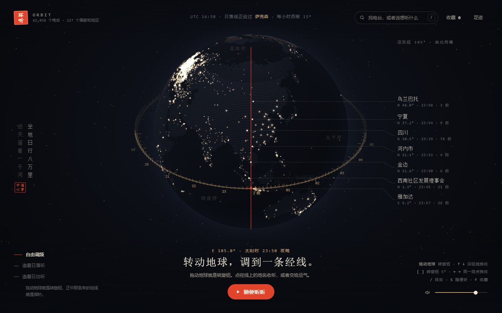

<div align="center">


# Orbit · 环听

**The Earth is the tuning dial. Turn it to a meridian and hear what's on air there right now.**

[简体中文](README.md) · English

[](LICENSE)
[](#-quick-start)
[](package.json)
[](https://www.radio-browser.info/)
[](#-deployment)



</div>

## 💡 The idea

Most world-radio maps scatter dots everywhere and leave you to pick one. Orbit turns the globe into a radio, inspired by the ancient Chinese armillary sphere:

- A **cinnabar meridian** in the middle of the screen is the needle. Dragging the globe turns the dial.
- An **equatorial ring** shows the local solar time of every meridian, so you can see where the sun is setting and where it's midnight.
- On the right, places with stations along the needle's meridian are listed **north to south**, with local time and station count.

Or pick **Chase the sunset**: the needle locks onto the meridian where the sun is setting and drifts west with Earth's rotation. Sit back and hear half the planet in one evening.

## ✨ Features

- 🧭 **Meridian tuning**: drag, arrow keys or `[` `]` to turn the dial; click a place to listen
- 🌅 **Chase the sunset / sunrise**: follows the day-night line automatically
- 🌍 **Real-time sunlit globe**: hand-written WebGL (no three.js), 60k+ stations clustered on a 0.5° grid
- 🤖 **Ask in one sentence**: "jazz in a Paris café", "lo-fi for coding". Works with any OpenAI-compatible model, and falls back to built-in keyword parsing without one
- 📍 **Nearby / similar stations**
- 🗺️ **Grouped by state / province** using Natural Earth boundaries; stations without coordinates are matched by state name
- 🎵 **Now playing**: song titles read from ICY metadata on the server, also shown in OS media controls
- 👣 **Footprints** of the last 12 hours drawn on the globe
- 🔗 **Share links** carrying the meridian, view and station
- ⏭️ **Dead streams skipped automatically** after 15 s; HLS supported (hls.js loaded on demand)
- 🌙 **Sleep timer**, ⌨️ **full keyboard control**, 📱 **mobile layout**
- 🪶 **Zero dependencies**: no `npm install`, no build step

## 🚀 Quick start

Requires Node.js 18+.

```bash
git clone https://github.com/Versior/orbit-radio.git
cd orbit-radio
node server.mjs        # or: npm start
```

Open <http://127.0.0.1:8765/>. On first start the server pulls the whole Radio Browser directory in the background to build `data/geo-clusters.json` (a few minutes). Until then the globe shows the top 2,500 stations. The cache refreshes every 24 hours.

## ⚙️ Configuration

Copy `.env.example` to `.env` (all optional; real environment variables take precedence).

| Variable | Default | Description |
|---|---|---|
| `AI_BASE_URL` | – | OpenAI-compatible base URL, without `/chat/completions` |
| `AI_MODEL` | – | Model name, e.g. `deepseek-chat`, `gpt-4o-mini` |
| `AI_API_KEY` | – | API key. Never commit it |
| `PORT` | `8765` | Listen port |
| `HOST` | `127.0.0.1` | Listen address; use `0.0.0.0` for LAN or containers |

## 📦 Deployment

```bash
# Docker Compose (v2.24+)
docker compose up -d

# Docker
docker build -t orbit-radio .
docker run -d -p 8765:8765 -v orbit-data:/app/data --env-file .env orbit-radio

# pm2
HOST=0.0.0.0 pm2 start server.mjs --name orbit-radio
```

Notes:

- **Over HTTPS, only HTTPS streams are listed**, because browsers block mixed content. Over HTTP every stream plays, but geolocation ("nearby") requires a secure context.
- **Behind a reverse proxy, rate limits become site-wide**: the server limits by socket address, so every request appears to come from `127.0.0.1`.
- **Static hosting** (GitHub Pages, Cloudflare Pages) works without the server. The globe shows the top 2,500 stations, AI search uses local parsing, and state grouping and song titles are unavailable.

See the [Chinese README](README.md#-部署) for systemd and Nginx examples.

## ⌨️ Shortcuts

| Key | Action |
|---|---|
| Drag / `[` `]` | Turn the dial 5° (`Shift` for 1°) |
| `↑` `↓` | Move along the meridian |
| `←` `→` | Previous / next station at this place |
| `Space` | Play / pause |
| `/` or `Ctrl` + `K` | Search |
| `S` · `F` · `M` | Shuffle · favourite · mute |
| `H` · `+` `-` | Reset view · zoom |

## 🔒 Privacy & security

- No accounts, no database. Favourites and history live in your browser's `localStorage`.
- Location sent to the AI endpoint is rounded to 0.1° (about 10 km). Prompts, replies and keys are never logged.
- The song-title endpoint only accepts a station uuid, resolves the stream URL itself, rejects private and loopback addresses, and connects to the resolved IP to prevent DNS rebinding.

## 🙏 Credits

[Radio Browser](https://www.radio-browser.info/) (station directory) · [Natural Earth](https://www.naturalearthdata.com/) (public-domain boundaries) · [hls.js](https://github.com/video-dev/hls.js) (Apache-2.0)

## 📄 License

[MIT](LICENSE) © 2026 [Versior](https://github.com/Versior)
