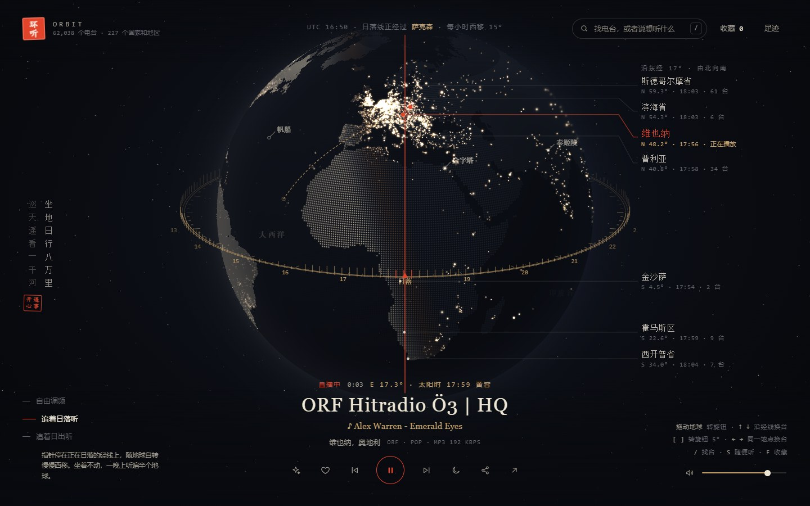
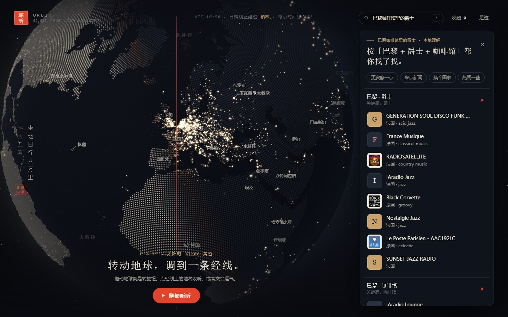
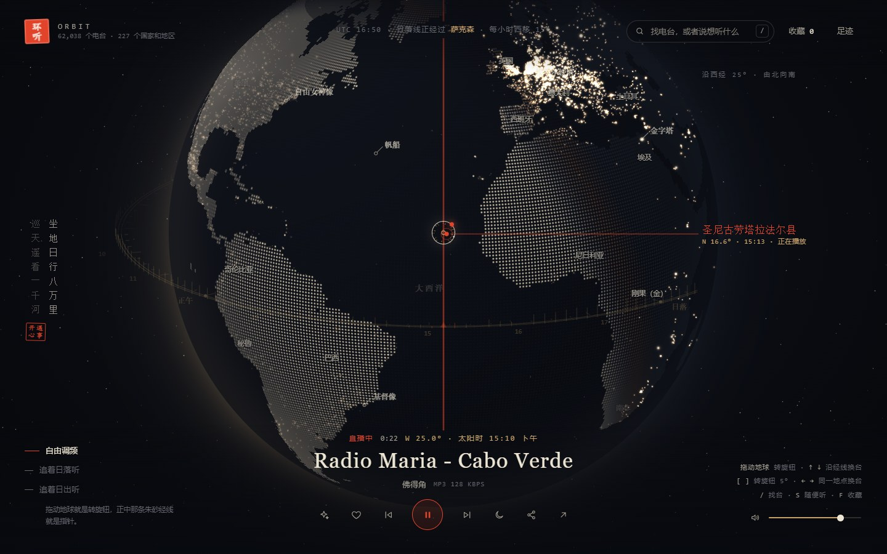
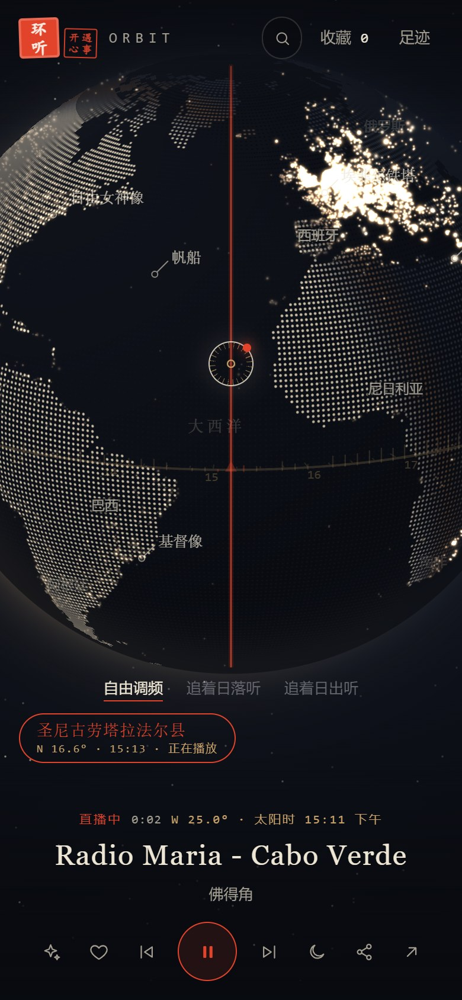
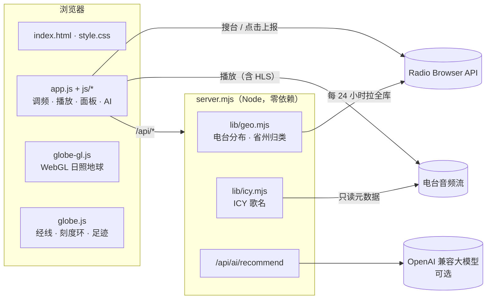

<div align="center">


# 环听 Orbit

**地球就是调频旋钮。转到一条经线，听那里此刻的电台。**

坐地日行八万里，巡天遥看一千河。

简体中文 · [English](README.en.md)

[](LICENSE)
[](#-快速开始)
[](package.json)
[](https://www.radio-browser.info/)
[](#-docker)
[](https://github.com/Versior/orbit-radio/stargazers)
[](https://github.com/Versior/orbit-radio/commits)


</div>

## 📖 目录

- [为什么做它](#-为什么做它)
- [功能](#-功能)
- [截图](#-截图)
- [快速开始](#-快速开始)
- [配置](#%EF%B8%8F-配置)
- [部署](#-部署)
- [快捷键](#%EF%B8%8F-快捷键)
- [架构](#%EF%B8%8F-架构)
- [接口](#-接口)
- [安全与隐私](#-安全与隐私)
- [常见问题](#-常见问题)
- [路线图](#%EF%B8%8F-路线图)
- [致谢](#-致谢)
- [许可证](#-许可证)

## 💡 为什么做它

市面上的全球电台地图大多是"地图上撒满点，点一个听一个"。点多了，人反而不知道该听哪儿。

环听换了个思路，借张衡浑天仪的样子，把地球做成一台收音机：

- 屏幕正中一条**朱砂经线**是指针，拖动地球就是转旋钮。
- 地球外面套一圈**赤道刻度环**，标出每条经线此刻的太阳时，日落和子夜在哪儿一眼就能看到。
- 右侧沿着指针那条经线，**由北向南**列出有电台的地点，并给出当地时间和台数。

你可以自己转，也可以选"追着日落听"：指针一直停在正在日落的那条经线上，跟着地球自转慢慢西移，坐着不动就能一晚上听遍半个地球。

## ✨ 功能

| | 功能 | 说明 |
|---|---|---|
| 🧭 | **经线调频** | 拖动地球、方向键或 `[` `]` 都能转旋钮，指针下那条经线上的地点按纬度排开，点一下就开始听 |
| 🌅 | **追着日落 / 日出听** | 指针锁定晨昏线，随地球自转自动换到下一个正在日落（或日出）的地方 |
| 🌍 | **实时日照地球** | 手写 WebGL 渲染，不依赖 three.js。按此刻真实的太阳位置区分昼夜，6 万多个电台按 0.5° 网格聚成光点 |
| 🤖 | **一句话找台** | "巴黎咖啡馆里的爵士""写代码时的 Lo-fi"。可以接任意 OpenAI 兼容的大模型，不配置时退回本地关键词理解，照样能用 |
| 📍 | **我附近 / 找相似** | 按定位找身边的台；按当前台的风格和国家找相似的台 |
| 🗺️ | **按省 / 州分区** | 用 Natural Earth 的省州边界归类。没有坐标的台按省州名补进来（Radio Browser 里中国 2000 多个台只有几十个带坐标，主要靠这一步） |
| 🎵 | **正在播的歌** | 服务端读取音频流里的 ICY 元数据，显示歌名，同时同步到系统媒体控制 |
| 👣 | **足迹** | 最近 12 小时听过的地方，在地球上连成一条虚线 |
| 🔗 | **分享** | 一条链接带上经线、视角和电台，对方打开就落在同一个地方 |
| ⏭️ | **失效台自动跳过** | 15 秒连不上就换下一个；支持 HLS（hls.js 按需加载） |
| 🌙 | **定时停止** | 15、30 或 60 分钟后自动停止 |
| ⌨️ | **全键盘操作** | 调频、换台、收藏、搜索、缩放都有快捷键 |
| 📱 | **手机适配** | 竖屏布局、触摸拖动、双指缩放、刘海屏安全区 |
| 🪶 | **零依赖** | 不需要 `npm install`，没有构建步骤，Node 18+ 直接跑 |

## 🖼 截图

<table>
  <tr>
    <td width="50%"><p align="center">追着日落听：指针停在维也纳的黄昏，下方是正在播的歌</p></td>
    <td width="50%"><p align="center">一句话找台：未配置大模型时用本地理解</p></td>
  </tr>
  <tr>
    <td width="50%"><p align="center">正在收听：准星和右侧刻度标出当前电台</p></td>
    <td width="50%" align="center"><p align="center">手机竖屏</p></td>
  </tr>
</table>

## 🚀 快速开始

需要 [Node.js](https://nodejs.org/) 18 或更高版本。不用安装任何依赖。

```bash
git clone https://github.com/Versior/orbit-radio.git
cd orbit-radio
node server.mjs        # 或 npm start
```

浏览器打开 <http://127.0.0.1:8765/>。

> [!NOTE]
> 首次启动时，服务端会在后台从 Radio Browser 分页拉一遍全库，生成电台分布缓存 `data/geo-clusters.json`，按网络情况需要几分钟。在这之前，前端先显示最热门的 2500 个台。缓存每 24 小时自动刷新一次。

## ⚙️ 配置

所有配置都是可选的。复制 `.env.example` 为 `.env` 后填写，也可以直接设成系统环境变量（系统环境变量优先）。

| 变量 | 默认值 | 说明 |
|---|---|---|
| `AI_BASE_URL` | 空 | OpenAI 兼容接口地址，不含 `/chat/completions`，例如 `https://api.deepseek.com` |
| `AI_MODEL` | 空 | 模型名，例如 `deepseek-chat`、`gpt-4o-mini`、`qwen-plus` |
| `AI_API_KEY` | 空 | 密钥。只放在 `.env` 或环境变量里，不要提交到仓库 |
| `PORT` | `8765` | 监听端口 |
| `HOST` | `127.0.0.1` | 监听地址。要让局域网或容器外访问，设为 `0.0.0.0` |

三个 `AI_*` 变量要全部填上才会启用大模型，少一个就自动退回本地理解。

## 📦 部署

| 方式 | 适合 | 功能 |
|---|---|---|
| [Node 直接运行](#node--pm2--systemd) | 自己的服务器、NAS | 全部 |
| [Docker](#-docker) | 有 Docker 的服务器 | 全部 |
| [纯静态托管](#纯静态托管github-pages--cloudflare-pages) | GitHub Pages、Cloudflare Pages | 部分（见下文） |

### Node / pm2 / systemd

```bash
# 前台运行
HOST=0.0.0.0 PORT=8765 node server.mjs

# 用 pm2 常驻
HOST=0.0.0.0 pm2 start server.mjs --name orbit-radio
```

<details>
<summary>systemd 服务示例</summary>

```ini
# /etc/systemd/system/orbit-radio.service
[Unit]
Description=Orbit Radio
After=network-online.target

[Service]
WorkingDirectory=/opt/orbit-radio
ExecStart=/usr/bin/node server.mjs
Environment=HOST=127.0.0.1
Environment=PORT=8765
Restart=on-failure
User=www-data

[Install]
WantedBy=multi-user.target
```

```bash
sudo systemctl enable --now orbit-radio
```

</details>

### 🐳 Docker

```bash
# docker compose（需要 Compose v2.24+；.env 可选）
docker compose up -d

# 或者手动
docker build -t orbit-radio .
docker run -d --name orbit-radio -p 8765:8765 \
  -v orbit-data:/app/data \
  --env-file .env \
  orbit-radio
```

镜像基于 `node:24-alpine`，用非 root 用户运行。`/app/data` 存电台分布缓存，挂成卷可以避免每次重启都重新拉全库。

### Nginx 反向代理 + HTTPS

```nginx
server {
    listen 443 ssl http2;
    server_name radio.example.com;

    ssl_certificate     /etc/letsencrypt/live/radio.example.com/fullchain.pem;
    ssl_certificate_key /etc/letsencrypt/live/radio.example.com/privkey.pem;

    location / {
        proxy_pass http://127.0.0.1:8765;
        proxy_set_header Host $host;
        proxy_read_timeout 30s;
    }
}
```

> [!IMPORTANT]
> - **HTTPS 下只列出 HTTPS 的台。** 浏览器会拦截 HTTPS 页面里的 HTTP 音频流（混合内容），所以页面是 HTTPS 时，前端只查询支持 HTTPS 的台，可选的台会少一部分。用 HTTP 访问能听到全部，但浏览器不允许在 HTTP 页面上获取定位，「我附近」用不了（`localhost` 除外）。
> - **反代后限流按整站算。** 服务端按连接来源 IP 限流（AI 找台每 IP 每分钟 20 次，歌名每 IP 每分钟 12 次）。放在反代后面时，所有请求都来自 `127.0.0.1`，等于全站共用一个额度，人多时歌名会频繁被限流。

### 纯静态托管（GitHub Pages / Cloudflare Pages）

把仓库根目录当成静态站点发布即可，不需要构建。前端在 `/api/*` 不可用时会自动降级：

| 功能 | 静态托管时 |
|---|---|
| 地球、经线调频、追日落、收藏、足迹、分享 | ✅ 正常 |
| 一句话找台 | ✅ 退回本地关键词理解 |
| 地球光点 | ⚠️ 只显示最热门的 2500 个带坐标的台 |
| 省 / 州分区 | ⚠️ 不可用，经线调频改按坐标就近找台 |
| 正在播的歌名 | ❌ 不显示 |

> [!WARNING]
> 用 `python -m http.server` 这类通用静态服务器时，它会把目录里的所有文件都发出去，包括 `.env`。静态托管时不要把 `.env` 放在站点目录里。自带的 `server.mjs` 只放行白名单里的扩展名，并且拒绝所有点文件。

## ⌨️ 快捷键

| 按键 | 作用 |
|---|---|
| 拖动地球 / `[` `]` | 转旋钮，每次 5° |
| `Shift` + `[` `]` | 微调，每次 1° |
| `↑` `↓` | 沿经线换地点 |
| `←` `→` | 同一地点换台 |
| `Space` | 播放 / 暂停 |
| `/` 或 `Ctrl` + `K` | 找台 |
| `S` | 随便听 |
| `F` | 收藏当前台 |
| `M` | 静音 |
| `H` | 回到初始视角 |
| `+` `-` | 缩放地球 |
| `Esc` | 关闭面板 |

## 🏗️ 架构



<details>
<summary>目录结构</summary>

```text
orbit-radio/
├── index.html            # 页面结构
├── style.css             # 浑天仪视觉：夜蓝、纸墨、黄铜、朱砂
├── app.js                # 入口：事件、快捷键、启动顺序
├── globe-gl.js           # WebGL 地球：真实日照、电台光点
├── globe.js              # 2D 叠加层：经线指针、赤道刻度环、经线刻度、足迹
├── landmarks.js          # 地球上的地标
├── intent.js             # 本地找台理解（不配大模型时用）
├── js/
│   ├── radio.js          # Radio Browser：选服务器、失败换下一个
│   ├── player.js         # 播放器：HLS、失效跳过、收藏、定时停止、歌名
│   ├── tune.js           # 调频：经线刻度、追日落 / 日出
│   ├── map.js            # 地球数据加载与交互
│   ├── panel.js          # 右侧面板：地点 / 收藏 / 足迹
│   ├── ai.js             # 一句话找台、我附近、找相似
│   ├── trail.js          # 足迹
│   ├── share.js          # 分享链接
│   ├── state.js          # 全局状态
│   └── util.js           # 工具函数
├── server.mjs            # HTTP 服务：静态文件 + API
├── lib/
│   ├── geo.mjs           # 电台分布缓存与省州归类
│   ├── icy.mjs           # 歌名读取（带 SSRF 防护）
│   └── region-name.mjs   # 省州名归一化
├── tools/build-world.mjs # 从 Natural Earth 生成 vendor/ 下的地图数据
├── vendor/               # 国家与省州的像素索引、中文名
├── Dockerfile
└── docker-compose.yml
```

</details>

## 🔌 接口

| 方法 | 路径 | 说明 |
|---|---|---|
| `GET` | `/api/geo` | 电台分布：0.5° 网格聚合点和各省州台数。缓存生成前返回 `503` |
| `GET` | `/api/region/:id` | 某个省 / 州里按点击量排序的电台 uuid，最多 100 个 |
| `GET` | `/api/now/:uuid` | 某个电台正在播的歌名。每 IP 每分钟 12 次，结果缓存 15 秒 |
| `GET` | `/api/ai/status` | 是否配置了大模型 |
| `POST` | `/api/ai/recommend` | 一句话 → 查询计划。请求体上限 8 KB，每 IP 每分钟 20 次，最多 2 个并发 |

电台详情和搜索由浏览器直接请求 [Radio Browser API](https://api.radio-browser.info/)。按官方要求，每次播放都会调用一次 `/json/url/:uuid` 上报点击。

## 🔒 安全与隐私

- **没有账号，没有数据库。** 收藏、足迹、音量、上次听的台都只存在你自己浏览器的 `localStorage` 里。
- **AI 请求最小化。** 位置只保留一位小数（大约 10 公里精度）；服务端日志只记录错误码和耗时，不记录提示词、回复或密钥。
- **大模型输出会被清洗。** 国家码、坐标范围、字段长度都会校验，非法内容直接丢弃。
- **歌名接口防 SSRF。** 前端只能传电台 uuid，流地址由服务端自己向 Radio Browser 查。连接前先解析域名，拒绝内网、回环、链路本地地址，再按解析出的 IP 直连（防 DNS 重绑定）。跳转次数、超时和读取字节数都有上限。
- **静态文件白名单。** 只放行指定扩展名，拒绝点文件和根目录之外的路径；`.json` 和 `.bin` 只允许 `vendor/` 下的地图数据。

> [!NOTE]
> `lib/icy.mjs` 默认不拦截 `198.18.0.0/15`，因为 Clash 等代理的 fake-ip 模式会把所有域名解析到这一段。部署到公网服务器、并且不走这类代理时，可以在 `v4Private()` 里把这一段加回去。

## ❓ 常见问题

<details>
<summary><b>有的台放不出来？</b></summary>

电台数据来自社区维护的 Radio Browser，部分流会失效、限地区或临时下线。连接 15 秒没有声音就会自动换下一个台；连续失败的台在本次访问里会被跳过。页面是 HTTPS 时，只会列出 HTTPS 的台。
</details>

<details>
<summary><b>不配大模型能用吗？</b></summary>

能。`intent.js` 内置了常见城市、国家、风格和语言的关键词理解，"东京本地电台""牙买加的雷鬼"这类说法都能直接转成查询。配置大模型后，模糊的说法（"此刻适合听什么""更安静一点"）理解得更好，也支持多轮追问。
</details>

<details>
<summary><b>为什么中国的很多台都显示在省会附近？</b></summary>

Radio Browser 里大部分中国电台没有坐标，只填了省份。服务端按省份名把它们归到对应的省，在地球上画在省会位置。
</details>

<details>
<summary><b>数据多久更新一次？</b></summary>

服务端每 24 小时重新拉一次全库。地图边界数据在 `vendor/` 下，只有边界变化时才需要用 `tools/build-world.mjs` 重新生成。
</details>

## 🗺️ 路线图

- [x] 经线调频、赤道刻度环
- [x] 追着日落 / 日出听
- [x] 一句话找台（大模型 + 本地兜底）
- [x] 按省 / 州分区
- [x] 正在播的歌名、足迹、分享链接
- [ ] 听过的歌：记录歌名，一键去音乐平台搜索
- [ ] 盲听猜地：随机放一个台，转动经线猜它在哪
- [ ] HTTPS 音频代理：HTTPS 部署下也能听 HTTP 的台
- [ ] 精选经线和主题合集
- [ ] PWA 安装、收藏导入导出、多标签页同步

欢迎在 [Issues](https://github.com/Versior/orbit-radio/issues) 里提想法。

## 🤝 参与贡献

1. Fork 本仓库
2. 新建分支：`git checkout -b feat/your-idea`
3. 提交改动：`git commit -m "feat: 你的改动"`
4. 推送并发起 Pull Request

项目刻意保持零依赖、无构建。新增功能时请尽量不要引入 npm 包。

## 🙏 致谢

- [Radio Browser](https://www.radio-browser.info/)：社区维护的开放电台目录，所有电台数据都来自这里
- [Natural Earth](https://www.naturalearthdata.com/)：公有领域的国界与省州边界数据
- [hls.js](https://github.com/video-dev/hls.js)：HLS 流播放（Apache-2.0，按需从 jsDelivr 加载）
- 首页诗句出自毛泽东《七律二首·送瘟神》

## 📄 许可证

[MIT](LICENSE) © 2026 [Versior](https://github.com/Versior)

<div align="center">
<sub>转动地球，收听世界。</sub>
</div>
